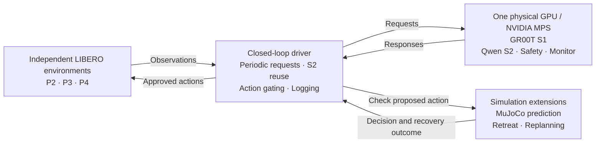

# Implementation and Evaluation of a Single GPU ROSA Reproduction Prototype

An independent implementation based on **ROSA: A Robotics Foundation Model Serving System for Robot Factories**. This project explores how shared foundation-model inference can serve multiple robots while respecting response-time and control requirements.

The prototype connects GR00T action generation, Qwen vision-language models, Ray and LIBERO/MuJoCo. All demonstrated robots are **independent simulated environments**. No physical robots or coordinated arms in a shared workspace were tested.

**Current status — 1 November 2026:** shared inference and real-model closed-loop execution have been demonstrated on one GPU. Full reproduction of the paper's performance and stable operation of the final recovery configuration remain incomplete. The current source is **v0.20.17**, whose Monitor termination fix passed CPU tests but has not been validated on a GPU. The last GPU-tested version is **v0.20.16**.

- [License scope and third-party terms](#licensing)
- [ROSA paper, v1](https://arxiv.org/abs/2607.01088v1)

## Scope and implementation status

| Area | Implemented and checked | Remaining work |
| --- | --- | --- |
| Shared S1 inference | Four P1 environments shared one GR00T model on a GPU; batching adapter checked against the official API | Full task-by-batch behavioral equivalence and maximum capacity |
| P1–P4 pipelines | Real S1, S2, Safety and Monitor backends connected to simulation | Stable integrated operation and semantic quality evaluation |
| Scheduling | Homogeneous placement, batch/frequency search, heterogeneous R07 scheduling and independent small-case checks on CPU | End-to-end GPU validation using formally accepted measured profiles |
| Dynamic operation | Admission/removal, reassignment, standby switching and dedicated/shared comparison paths checked on CPU | Multi-GPU execution, real-model migration and GPU failure recovery |
| Measurement | Request/action logs, periodic-slot audits, qualified throughput, profile validation and evidence collection | Complete accepted profile curves and the full behavioral evaluation matrix |
| Simulation extensions | MuJoCo contact/distance prediction, independent retreat and replanning exercised on a GPU | P4 recovery failures and consistent timing/periodic fulfillment |

P1 follows ROSA's one-model-per-GPU placement principle at a reduced scale. **Colocating P2–P4 components on one GPU, MPS tuning, geometric prediction and retreat are project extensions.** They are not presented as the paper's original implementation. The reported GPU trials used explicit operating settings, not a formally adopted R07 optimum.

R07 returns a checked feasible lower bound; it does not guarantee global optimality. The sample scheduling profiles are synthetic, and CPU feasibility is not a guarantee of GPU deadline performance.

## Architecture



The diagram represents the final GPU configuration. P1 uses S1 alone. S2 supplies a short plan reused by S1; Safety can inhibit the next action chunk; Monitor reports task status. Simulator-reported success determines task completion. Safety gating was not evaluated as an emergency interruption of an already executing chunk.

| Pipeline | Components | Tested population |
| --- | --- | --- |
| P1 | S1 | Four independent environments sharing one model |
| P2 | S1 + Monitor | One environment in the colocated trials |
| P3 | S1 + Safety + Monitor | One environment in the colocated trials |
| P4 | S1 + S2 + Safety + Monitor | One environment in the colocated trials |

The integrated tests used the LIBERO T01 object-placement task. P4 names the component composition; it does not mean that the paper's assembly task was reproduced.

## Quick start: CPU examples

These commands run scheduling and log-evaluation examples without loading robot models or using a GPU. Run them from the repository root with Python 3.12:

```bash
python3.12 -m venv .venv
.venv/bin/python -m pip install -r requirements.lock

# Homogeneous and heterogeneous scheduling with synthetic profiles.
PYTHONPATH=src .venv/bin/python -m rosa_repro.cli solve examples/p4.json
PYTHONPATH=src .venv/bin/python -m rosa_repro.cli solve-heterogeneous examples/r07_weighted.json

# Evaluate supplied P1 and multicomponent event fixtures.
PYTHONPATH=src .venv/bin/python -m rosa_repro.cli evaluate-p1 examples/p1_measurement.json
PYTHONPATH=src .venv/bin/python -m rosa_repro.cli evaluate-pipeline examples/p4_horizon_audit.json

# Focused CPU tests for the examples' core mechanisms.
PYTHONPATH=src .venv/bin/python -m pytest -q \
  tests/test_scheduler.py tests/test_multicomponent.py tests/test_heterogeneous.py
```

`requirements.lock` is the CPU environment lock. It does **not** install the full GPU model stack. Broader Ray, model-backend and media tests require their corresponding environments; see the relevant documents below.

| Output | Meaning |
| --- | --- |
| `status=feasible` | The returned configuration satisfies the supplied profile model |
| `status=infeasible` | Infeasibility was established within the declared constraints and capacity bounds |
| `status=unknown` | Missing measurements, time limits or unexplored alternatives prevent a decision |
| `gpu_execution=false` | No GPU inference was performed |
| `solution_quality` / `optimality_proven` | Qualification of the search result; inspect before interpreting it as an optimum |

Commands with an output directory require a fresh destination and preserve existing results. For a documented case in which the paper-style first placement leaves an alternative unexplored, see [implementation notes](docs/implementation.md) and `examples/unresolved_packing.json`.

## GPU environment and models

The table describes the measured environment, not a minimum hardware requirement or a claim of compatibility with other GPUs.

| Item | Recorded configuration |
| --- | --- |
| GPU | 1 × NVIDIA RTX PRO 6000 Blackwell Server Edition; 97,887 MiB reported memory |
| Platform | Linux, Python 3.12.3, NVIDIA driver 595.91.07, CUDA 12.8 |
| Model runtime | PyTorch 2.9.0+cu128, Transformers 4.57.3, vLLM 0.11.2, Ray 2.59.0 |
| Simulation | LIBERO, MuJoCo 3.3.1 |
| S1 | NVIDIA GR00T N1.7 LIBERO, `libero_object`, BF16 |
| S2 and Monitor | Separate Qwen2.5-VL-7B-Instruct instances, FP16 |
| Safety | Qwen2.5-VL-3B-Instruct, FP16 |
| Safety comparison only | Qwen3-VL-4B-Instruct and Qwen3-VL-8B-Instruct |

Exact source commits, model revisions, remaining dependencies and per-trial settings are recorded in **Appendices B–D of the English report** and the reproduction archive. Model weights and upstream GR00T/LIBERO code must be obtained separately from their respective providers. Configure authentication in the deployment environment; do not put tokens in configuration files or logs.

The model stack uses a separate environment from the CPU lock. The recorded Qwen vision-attention configuration uses `TORCH_SDPA`; preserve the version-specific compatibility handling rather than assuming arbitrary attention backends are interchangeable.

## Reproduce a recorded experiment

Use the **versioned reproduction archive** for historical trials. Running current v0.20.17 source does not recreate the v0.20.16 GPU experiment.

1. Obtain the ZIP using the [reproduction asset instructions](docs/REPRODUCTION_ASSETS.md), then extract it. From its extracted root, verify the files with `sha256sum -c SHA256SUMS` on Linux.
2. Select a case in `reproduction_index.json`. Use `sources/index.json` to match its source archive and SHA-256. The archive includes 15 source snapshots, 11 closed-loop cases, individual profile settings and 227 saved observations. It excludes model weights and the complete raw time-series logs.
3. Build the common model and simulator environments using `environment/shared_environment_lock.json` and the selected version's environment scripts. Recheck full weights, CUDA/EGL, input contracts and runtime evidence on the new host.
4. Copy `paths.template.json` to `paths.json` and replace the deployment placeholders with absolute paths. From the archive root, prepare a case:

```bash
python prepare_reproduction.py \
  --case E7-v16 \
  --paths paths.json \
  --output prepared/E7-v16
```

Preparation extracts the matching source and state banks, rebuilds the suite, validates its source binding and preserves the original experiment identity in `preparation.json`. It does not start Ray, load models or run a GPU trial. Use an environment with the project's CPU preparation dependencies installed.

5. Set `TRIAL_ROOT` to the absolute preparation directory. Set `COMMON_PYTHON`, `SIM_PYTHON`, `GROOT_REPO` and `RAY_ADDRESS` for the deployment. Start Ray in the common environment, configure EGL and the recorded thread limits, and establish the recorded MPS settings before loading models. Then run:

```bash
"$COMMON_PYTHON" "$TRIAL_ROOT/source/scripts/prototype_validation.py" run \
  --suite "$TRIAL_ROOT/suite.json" --root "$TRIAL_ROOT" \
  --output "$TRIAL_ROOT/new-run-1" --sim-python "$SIM_PYTHON" \
  --sim-repo "$GROOT_REPO" --address "$RAY_ADDRESS" --rep 0
```

Replicate indices start at zero. Use fresh model instances and output directories for each run. Preserve failures, raw records and GPU/MPS evidence. In the v0.20.16 workflow, recordings were written to local host storage and copied to persistent storage with hash verification afterward. **`status=complete` means the run completed; it does not mean that timing, stop-rate, recovery or task-success criteria passed.**

For exact environment variables, model pins, case settings and individual profiling commands, follow Appendix F of the report and `README.txt` in the archive. Historical repetitions remain distinct from newly executed repetitions: E4 measured one of three planned runs; E7-v16 measured two of three, with the second audit interrupted during copying.

Archive SHA-256:

```text
ee83463004ccd24c7aea2abbaa5baf974f280b580e67ca4545e8013085046f5d
```

## Selected results

These observations come from different versions and conditions. They should not be combined into a claim that one final configuration achieved every objective.

| Experiment | Observed result | Interpretation |
| --- | --- | --- |
| P1 shared inference | Four environments; 223 qualified action chunks in 30 s; Q = 7.4333/s; S1 p99 = 120.16 ms | Shared real-model control demonstrated at this load |
| Isolated S1 profile | 3,000/3,000 normal responses at 8 Hz, no missing responses; replicate p99 values 94.72 / 97.47 / 96.97 ms | One tested rate, not a maximum-capacity estimate |
| v0.20.8 colocated timing | All observed component p99 targets met in three 300 s runs | P3/P4 still stopped on Safety decisions |
| Qwen3 Safety comparisons | Both 4B and 8B produced 100% P3/P4 original-S1 stop rates in their 120 s measurement windows | Model replacement alone did not resolve stopping in these conditions |
| v0.20.15 recovery confirmation | P3 stops: 7.34%, 5.21%, 5.61%; P4 stops: 0%, 0%, 0.40% | Only the third run passed all fixed criteria |
| v0.20.16 final GPU confirmation | Run 1: P3 stops 4.76%, P4 stops 100%; run 2: P3 Monitor fulfilled 148/150 slots (98.67%) | Recovery and periodic fulfillment remained unresolved; no third run |
| v0.20.17 Monitor termination fix | 45 related CPU tests passed in the recorded validation | GPU validation pending |

Worst observed p99 across classes and replicates in **v0.20.8**:

| Component | Target (ms) | Worst p99 (ms) | Requests | Individual deadline overruns |
| --- | ---: | ---: | ---: | ---: |
| S1 | 200 | 198.28 | 4,990 | 15 |
| Safety | 500 | 218.43 | 3,600 | 0 |
| S2 | 2,000 | 1,132.70 | 151 | 0 |
| Monitor | 2,000 | 840.86 | 1,350 | 0 |

These are maxima of per-class, per-replicate p99 values, not pooled percentiles. A passing p99 does not mean every request met its deadline. Missing/invalid responses and periodic fulfillment are evaluated separately.

**Qualified throughput (Q)** counts applied action chunks satisfying the required timing and dependency checks. **Original-S1 stop rate** counts rejected original proposals divided by original action decisions; it is not a task-failure rate. Independent retreat actions do not count as successful original S1 actions. The exploratory 90% stop-rate threshold is a project engineering goal, not a safety-quality benchmark from ROSA.

Full conditions, denominators, unsuccessful trials and interpretation limits are retained in the English report.

## Known limitations and next steps

1. **Validate the Monitor termination fix on GPU.** Scheduled requests due at episode completion must retain their original timestamps, avoid duplicate dispatch and stay attached to the correct episode.
2. **Resolve P4 recovery failures.** The final failed run predicted a fingertip-to-floor distance of about 1.752 mm against a 2 mm criterion and exhausted consecutive retreats. Replay fixed failure states and compare action proposals, contact rules and recovery paths.
3. **Evaluate semantic quality.** Safety/Monitor accuracy, missed hazards, false stops and S2 planning quality lack completed human-label evaluation. Shorter outputs and model replacements can change decisions as well as latency.
4. **Complete integrated confirmation and profiling.** Use previously unused states, freeze acceptance criteria, retain unsuccessful runs and complete the full behavioral/profile acceptance process before capacity comparisons.
5. **Evaluate scaling and operational behavior.** Multi-GPU performance, physical GPU failover, generic component-specific fallback, Monitor-driven bounded task retry/handoff, energy and monetary savings remain unverified or incomplete.

The paper's multi-GPU speedups and supported robot counts were not reproduced. The single-GPU results should not be extrapolated to them.

## Repository guide

| Path | Purpose |
| --- | --- |
| `src/rosa_repro/` | Scheduling, contracts, model adapters, execution and evaluation |
| `scripts/` | Profiling, experiment preparation, execution, evidence and audit entry points |
| `examples/` | Synthetic scheduling profiles, event fixtures and deployment templates |
| `schemas/` | JSON schemas; additional semantic checks are implemented in Python |
| `tests/` | CPU regression tests and environment-specific integration tests |
| `docs/` | Detailed implementation and experiment notes, primarily in Japanese |
| `RESULTS.md` | Public result summary and interpretation limits |
| `reports/` | English submission report, PDF and DOCX |
| `media/` | Fixed English demonstrations and source/frame-mapping sidecars |
| `docs/REPRODUCTION_ASSETS.md` | Versioned reproduction ZIP, supplied separately as a Release asset |
| `SHA256SUMS` | SHA-256 inventory of this publication snapshot |

Useful implementation notes:

- [Scheduling and implementation contracts](docs/implementation.md)
- [Measurement definitions](docs/measurement.md)
- [Single-GPU integration](docs/single-gpu-prototype.md)
- [Parallel roles](docs/parallel-role-prototype.md) and [batching/phase offsets](docs/colocated-batching-phases.md)
- [Simulation geometric checks](docs/SIMULATION_HYBRID_SAFETY.md) and [recovery changes](docs/recovery-visibility-deadlines.md)
- [Monitor termination fix](docs/periodic-terminal-drain.md)
- [Detailed reproduction status](docs/REPRODUCTION_STATUS_20261101.md)

Raw experimental logs and host-specific operational records are intentionally omitted. Historical result paths in the notes identify records in the original archive; they are not bundled downloads. See [the publication scope](PUBLICATION.md).

Some documents describe an earlier version. Match the version and source identity to the experiment before applying its settings.

## Reference

Wenqi Jiang et al. **ROSA: A Robotics Foundation Model Serving System for Robot Factories.** arXiv:2607.01088v1, 2026. [Paper](https://arxiv.org/abs/2607.01088v1).

This repository is an independent reproduction project, not an official NVIDIA ROSA release. Third-party sources include [Isaac-GR00T](https://github.com/NVIDIA/Isaac-GR00T), [LIBERO](https://github.com/Lifelong-Robot-Learning/LIBERO), [GR00T model weights](https://huggingface.co/nvidia/GR00T-N1.7-LIBERO), [Qwen model weights](https://huggingface.co/Qwen), [Ray](https://github.com/ray-project/ray), [vLLM](https://github.com/vllm-project/vllm) and [OR-Tools](https://github.com/google/or-tools).

## Licensing

**The original software in this repository is licensed under the [Apache License 2.0](LICENSE).** This covers project-authored code, scripts, tests, schemas, configuration templates and repository documentation, subject to the exceptions below. See [NOTICE](NOTICE) and [THIRD_PARTY_NOTICES.md](THIRD_PARTY_NOTICES.md) for attribution and bundled license texts.

| Material | License / treatment |
| --- | --- |
| Original project software and repository documentation | Apache-2.0 |
| Isaac-GR00T and vLLM configuration excerpts retained in the source | Their upstream Apache-2.0 terms and attribution; see the [third-party notices](THIRD_PARTY_NOTICES.md) |
| NVIDIA GR00T-N1.7-LIBERO model weights; Cosmos-Reason2-2B dependency | NVIDIA Open Model License Agreement and provider access terms; obtained separately |
| Qwen2.5-VL-3B-Instruct, used for Safety | **Qwen RESEARCH LICENSE AGREEMENT: non-commercial research/evaluation; commercial use requires a separate license from Alibaba Cloud** |
| Qwen2.5-VL-7B-Instruct; Qwen3-VL-4B/8B-Instruct comparison models | Apache-2.0 according to the pinned upstream model cards; weights obtained separately |
| LIBERO software | Upstream MIT license; simulator assets and datasets retain their applicable upstream terms |
| Noto Sans JP fonts embedded in the report | SIL Open Font License 1.1; [copyright and license text](LICENSES/NotoSansJP-OFL.txt) |
| Fixed reports, figures and videos in `reports/` and `media/`; saved observations and state banks in the reproduction ZIP | Excluded from the repository-wide Apache grant. No additional blanket content license is granted in this release; third-party material retains its original terms |

**The Apache-2.0 software license does not authorize unrestricted commercial use of the complete recorded model stack.** In particular, the pinned [Qwen2.5-VL-3B license](https://huggingface.co/Qwen/Qwen2.5-VL-3B-Instruct/blob/66285546d2b821cf421d4f5eb2576359d3770cd3/LICENSE), Sections 1(i) and 2, limits its standard grant to non-commercial research/evaluation and requires a separate license for commercial use. The project does not grant model rights on behalf of its providers.

See the pinned [GR00T model card](https://huggingface.co/nvidia/GR00T-N1.7-LIBERO/blob/2ea293aa20ba7cf5bbf3ba17a5fbcb1a01cbfe21/README.md), the [NVIDIA Open Model License Agreement](https://www.nvidia.com/en-us/agreements/enterprise-software/nvidia-open-model-license/), and the [Cosmos model/access page](https://huggingface.co/nvidia/Cosmos-Reason2-2B). The Apache license of the Isaac-GR00T **code** and the license of GR00T **model materials** have separate scopes. Model weights are not bundled here.

**Built on NVIDIA Cosmos:** the recorded GR00T-based prototype uses the Cosmos-Reason2 dependency. Preserve applicable NVIDIA model attribution requirements when redistributing or deploying a system that uses it; see Section 3 of the NVIDIA agreement.

The reports and videos retain their fixed content and checksums. CC BY 4.0 has not been assigned to them. The font license applies to the font software and does not determine the report's content license. Keep applicable font/asset notices with redistributed materials.

The historical reproduction ZIP is accompanied by `ROSA_licenses_and_notices_20261101.zip`; distribute the two together with their checksum file. The companion supplies the software license scope and notices without modifying historical source archives. See [reproduction assets](docs/REPRODUCTION_ASSETS.md) and [the detailed license scope](docs/LICENSE_SCOPE.md).

Other installed libraries, datasets, CUDA components and runtime dependencies retain their respective licenses. This summary covers the included excerpts/fonts and named model dependencies; it is not a license inventory of every package in the GPU environment. The ROSA paper is cited as a research reference; its license does not establish the license of this independent implementation, and no NVIDIA endorsement is claimed.
